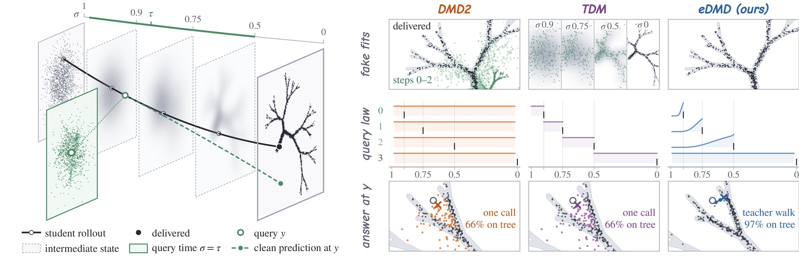
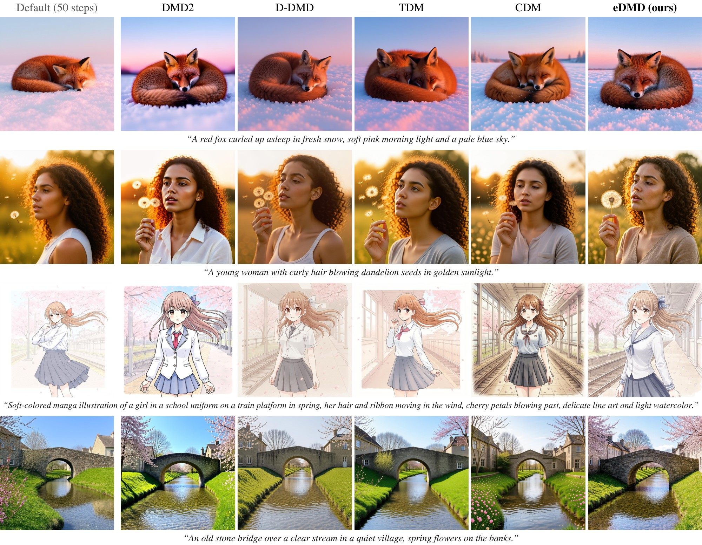

<div align="center">

# eDMD: Endpoint Distribution Matching for Few-Step Diffusion Distillation

[](https://arxiv.org/abs/2611.17194)
[](https://huggingface.co/zttzzt/eDMD)
[](LICENSE)

[Tong Zhao](https://tongzhao1030.github.io/)<sup>1,2,3</sup>, [Xianfang Zeng](https://scholar.google.com/citations?user=tgDc0fsAAAAJ&hl=en)<sup>3</sup>, [Yucheng Han](https://tingxueronghua.github.io/)<sup>3</sup>, [Ruoyu Wang](https://github.com/RuoyuWang-2077)<sup>2</sup>, [Mingkun Lei](https://mingkunlei.github.io/en/)<sup>3</sup>, [Gang Yu](https://www.skicyyu.org/)<sup>3</sup>, [Chi Zhang](https://icoz69.github.io/)<sup>2,📧</sup>

<sup>1</sup>Zhejiang University&emsp;<sup>2</sup>AGI Lab, Westlake University&emsp;<sup>3</sup>StepFun

📧 Corresponding author

</div>


<div align="center">
<i>4-step samples from eDMD distilled from Qwen-Image-2.1.</i>
</div>

## 🔍 What is eDMD?

A few-step student delivers only its **last step's output**, so eDMD distills around that image:

- 🎯 **Endpoint critic**: the fake (critic) model is fitted to the delivered images only.
- 🧭 **Precise teacher (PT)**: below the last step's input noise level, the teacher answers with a four-node guided
  walk to the clean image instead of a single call.
- 📐 **Calibrated queries**: earlier steps are queried above their landing level, with a density measured once per
  teacher.

It distills SD3-Medium, FLUX.2 [klein] 4B / 9B and Qwen-Image-2.1, on Ascend NPUs or NVIDIA GPUs.



<div align="center">
<i>One update of a 4-step student under DMD2, TDM and eDMD, on a toy tree-shaped teacher.</i>
</div>

## 🖼️ Results



<div align="center">
<i>FLUX.2 [klein] 4B. Leftmost: the teacher (50 steps, CFG 4). Others: 4-step students, same prompt and noise per row.</i>
</div>

## ⚡ Quick Start

```bash
git clone https://github.com/Westlake-AGI-Lab/eDMD.git && cd eDMD
pip install -r requirements/train.txt            # Python 3.10

export EDMD_MODEL_ROOT=/path/to/models
hf download black-forest-labs/FLUX.2-klein-base-4B --local-dir $EDMD_MODEL_ROOT/black-forest-labs/FLUX.2-klein-base-4B

# sample with the released student
python scripts/infer.py --weights zttzzt/eDMD/flux2_klein_4b/edmd_flux2_klein_4b_lora.safetensors --prompt "a red fox in fresh snow"

# or train your own on 8 cards (needs the training prompts, see Data)
bash scripts/train.sh 8 configs/runs/flux2_klein_4b/edmd.yaml
```

## 🛠️ Installation

```bash
pip install -r requirements/train.txt      # SD3-Medium and FLUX.2
pip install -r requirements/qwen.txt       # Qwen-Image-2.1, in a separate environment
```

On Ascend NPUs, also install `torch_npu` for torch 2.8 (CANN 8.3). The teachers and their run files:

| Teacher | Weights | Run file |
|---|---|---|
| SD3-Medium | [stabilityai/stable-diffusion-3-medium-diffusers](https://huggingface.co/stabilityai/stable-diffusion-3-medium-diffusers) | `configs/runs/sd3_medium/edmd.yaml` |
| FLUX.2 [klein] 4B | [black-forest-labs/FLUX.2-klein-base-4B](https://huggingface.co/black-forest-labs/FLUX.2-klein-base-4B) | `configs/runs/flux2_klein_4b/edmd.yaml` |
| FLUX.2 [klein] 9B | [black-forest-labs/FLUX.2-klein-base-9B](https://huggingface.co/black-forest-labs/FLUX.2-klein-base-9B) | `configs/runs/flux2_klein_9b/edmd.yaml` |
| Qwen-Image-2.1 | [Qwen/Qwen-Image-2.1](https://huggingface.co/Qwen/Qwen-Image-2.1) | `configs/runs/qwen_image_21/edmd.yaml` |

Download them under `$EDMD_MODEL_ROOT` (gated ones need their license accepted and `hf auth login`):

```bash
hf download <weights> --local-dir $EDMD_MODEL_ROOT/<weights>      # <weights>: a repository of the table above
```

## 📦 Data

The evaluation prompts ship in `datasets/eval/`. The training prompts are CDM's `mixed_200k` split:

```bash
curl -L --create-dirs https://raw.githubusercontent.com/byliutao/CDM/main/dataset/mixed_200k/train.txt -o datasets/train/mixed_200k_train.txt
```

Qwen-Image-2.1 trains on these prompts rewritten by its
[prompt enhancer](https://github.com/QwenLM/Qwen-Image-2.1/tree/main/prompt_rewrite) (vLLM):

```bash
git clone https://github.com/QwenLM/Qwen-Image-2.1
python -c "import json; [print(json.dumps({'id': i, 'prompt': p.strip()})) for i, p in enumerate(open('datasets/train/mixed_200k_train.txt')) if p.strip()]" > datasets/train/pe_input.jsonl
python Qwen-Image-2.1/prompt_rewrite/run_vllm.py --task t2i --ckpt Qwen/Qwen-Image-2.1-PE-T2I \
    --input datasets/train/pe_input.jsonl --output datasets/train/mixed_200k_clean/train_pe.jsonl
```

## 🚀 Training

```bash
bash scripts/train.sh 8 configs/runs/flux2_klein_4b/edmd.yaml                                     # 8 cards (a divisor of 16)
bash scripts/train.sh 8 configs/runs/flux2_klein_4b/edmd.yaml --set method.updates.max_steps=3000   # change any config value
```

Each teacher has its run file (see Installation). Running the same command again resumes from the latest checkpoint in
`outputs/<run name>/`. Logs go to W&B (offline without `wandb login`). For several nodes, see `scripts/train.sh`.

To evaluate every checkpoint during training as well (one node, needs the [reward models](eval/README.md)):

```bash
python -m edmd.cli.coordinate --nproc 8 --run-file configs/runs/flux2_klein_4b/edmd.yaml \
    --score-python <scorer env>/bin/python --hpsv3pp-python <HPSv3++ env>/bin/python
```

<details>
<summary>Calibrating a new teacher</summary>

The query density is measured once per teacher, guidance and student grid, from the teacher alone:

```bash
R=configs/runs/<model>/edmd.yaml
D=outputs/calibration/<model>
python -m edmd.cli.calibrate plan --run-file $R --out $D
python -m edmd.cli.calibrate shard --run-file $R --plan $D/plan.jsonl --device cuda:$r --rank $r --world $N --out $D   # r = 0..N-1
python -m edmd.cli.calibrate aggregate $D --json configs/calibration/<model>.json
```

The run file then reads it with `calibration: <model>`.

</details>

## 📊 Evaluation

DrawBench-1000 (200 prompts, 5 seeds each), scored with HPSv3++, HPSv3, PickScore, Aesthetic, HPSv2.1, ImageReward
and CLIP score ([setup](eval/README.md)):

```bash
# render: a checkpoint (add --role student_ema for its EMA weights), or the teacher
python -m edmd.cli.evaluate generate --checkpoint outputs/flux2_klein_4b_edmd/checkpoint-1000 \
    --eval drawbench1k --out outputs/eval/flux2_klein_4b
python -m edmd.cli.evaluate generate --teacher --config configs/runs/flux2_klein_4b/edmd.yaml --steps 50 --cfg 4 \
    --eval drawbench1k --out outputs/eval/flux2_klein_4b

# score in the reward models' environments, then print the table
python -m edmd.cli.evaluate score --dir outputs/eval/flux2_klein_4b
python -m edmd.cli.evaluate score --dir outputs/eval/flux2_klein_4b --metrics hpsv3pp
python -m edmd.cli.evaluate summary --dir outputs/eval/flux2_klein_4b
```

Qwen-Image-2.1 uses `--eval drawbench1k_pe_aspect1k`.

## 🎨 Sampling

```bash
python scripts/infer.py --weights zttzzt/eDMD/flux2_klein_4b/edmd_flux2_klein_4b_lora.safetensors --prompt "a red fox in fresh snow"
python scripts/infer.py --weights outputs/flux2_klein_4b_edmd/checkpoint-1000 --prompt "a red fox in fresh snow"
```

The released students on [zttzzt/eDMD](https://huggingface.co/zttzzt/eDMD) (`sd3_medium/`, `flux2_klein_4b/`,
`flux2_klein_9b/`) are diffusers LoRAs; see the model card for the diffusers call.
`python scripts/convert_lora.py --weights <checkpoint>` exports your own checkpoint the same way.

## 📂 Project Structure

```
eDMD/
├── edmd/
│   ├── algo/         # queries, critic and generator losses, teacher engine (PT), rollouts, calibrated law
│   ├── methods/      # DistillationStep: one student update
│   ├── models/       # sd3/, flux2/, qwen_image/ adapters
│   ├── training/     # training loop and prompt data
│   ├── evaluation/   # evaluation cases, image generation, scoring
│   ├── runtime/      # FSDP2, LoRA, checkpoints, EMA, devices
│   ├── config/       # config schema and composition (model + method + eval + run file)
│   ├── tracking/     # Weights & Biases
│   └── cli/          # train, coordinate, evaluate, sample, calibrate
├── configs/
│   ├── models/       # the four teachers
│   ├── methods/      # method presets
│   ├── runs/         # <model>/edmd.yaml: one run file per teacher
│   ├── eval/         # DrawBench-1000 evaluation configs
│   └── calibration/  # the teachers' calibration tables
├── scripts/          # train.sh (torchrun launcher), infer.py (diffusers sampling), convert_lora.py (diffusers LoRA)
├── eval/             # the reward models: one module per metric, image-directory scoring, weight download
└── datasets/         # evaluation prompts (training prompts go in datasets/train/)
```

## ✅ TODO

- [ ] Release the Qwen-Image-2.1 LoRA weights
- [x] Release the training code
- [x] Release the inference code and LoRA weights (SD3-Medium, FLUX.2 [klein] 4B / 9B)
- [x] Release the paper

## 📝 Citation

```bibtex
@misc{zhao2026edmdendpointdistributionmatching,
      title={eDMD: Endpoint Distribution Matching for Few-Step Diffusion Distillation}, 
      author={Tong Zhao and Xianfang Zeng and Yucheng Han and Ruoyu Wang and Mingkun Lei and Gang Yu and Chi Zhang},
      year={2026},
      eprint={2611.17194},
      archivePrefix={arXiv},
      primaryClass={cs.CV},
      url={https://arxiv.org/abs/2611.17194}, 
}
```

## 🙏 Acknowledgements

We referred to the code of [CDM](https://github.com/byliutao/CDM), [TDM](https://github.com/Luo-Yihong/TDM),
[RTDMD](https://github.com/Harahan/RTDMD) and [DMD2](https://github.com/tianweiy/DMD2), and use
[diffusers](https://github.com/huggingface/diffusers) and the reward models listed in [`eval/README.md`](eval/README.md).
We thank their authors for open-sourcing them.

## 📄 License

The code is released under the [Apache License 2.0](LICENSE). The teachers, the released students, the prompt sets
and the reward models keep their own licenses.
